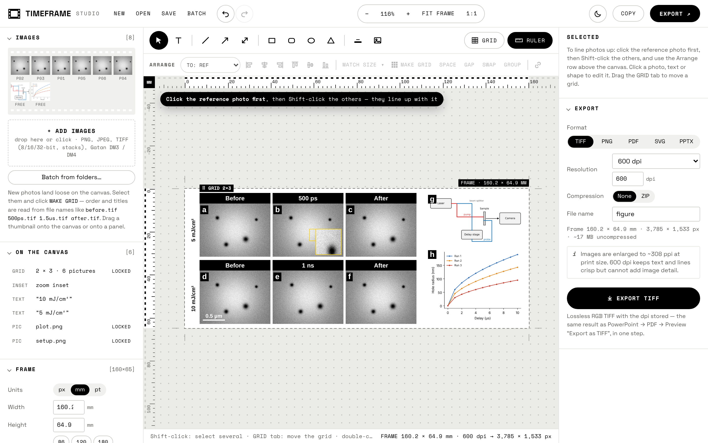
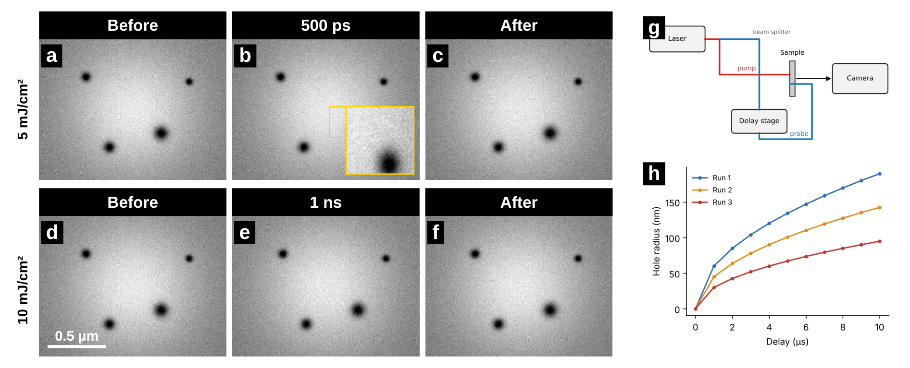
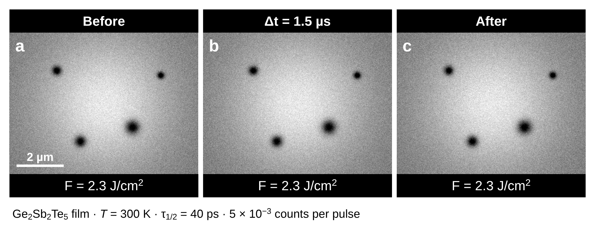

# TimeFrame Studio

**Publication-ready microscopy figures — Before · time-resolved · After — in one HTML file. Your pixels are never changed.**

[**▶ Open the app**](https://YOUR-USERNAME.github.io/timeframe-studio/) · [User guide (PDF)](docs/TimeFrame_Studio_User_Guide.pdf) · [Example project](examples/demo.tfs.json)

TimeFrame Studio replaces the PowerPoint → PDF → Preview “Export as TIFF” routine with one tool made for microscopy figures. You bring the images; it arranges, labels, lines up and exports them — losslessly. It is a single HTML file that runs in your browser: nothing to install, and **nothing is uploaded** — your images stay on your computer.

## Features

**Bring in images**
- TIFF (8/16/32-bit, multi-page stacks, LZW / ZIP / PackBits), PNG, JPEG and **Gatan DM3 / DM4** (2-D images and stacks).
- Pixel size read from ImageJ, OME, FEI/Thermo and DigitalMicrograph metadata → calibrated scale bars.
- Order and titles read from file names: `before`, `500ps`, `1.5us`, `after`… one row per run.

**Arrange (BrightSlide-style)**
- A free canvas with an export frame you size yourself (journal widths 86 / 120 / 180 mm).
- The thing you click first is the reference: align edges and centres, match size — or only the **width** or **height**, keeping proportions — space evenly, type an exact **gap** between facing sides, swap.
- Lock an alignment or a gap so it holds when things move. Group, turn (any angle) and mirror; lossless 90° turns.
- Time-series grids: columns, rows and gaps; drag a corner and titles, letters, scale bars and labels scale with it.

**Annotate**
- Text with **LaTeX-style formulas** (`\Delta t = 1.5 \mu s`, `J/cm^2`, `Ge_2Sb_2Te_5`) drawn in the figure’s own font.
- Arrows, shapes, calibrated scale bars, zoom insets, panel letters (a b c…), row labels.
- **Repeat** a label on every panel, a row or a column — copies move and scale with the grid.
- Colour palettes: colour-blind-safe (Okabe–Ito), ImageJ channel colours, Fire / Viridis / Magma.

**Honest images**
- Brightness and contrast are display-only and linear, linked across panels so intensities stay comparable.
- **Native 1:1** mode: one camera pixel = one exported pixel. Checks before export (missing calibration, small text, items cut by the frame…).

**Export & share**
- **TIFF, PNG** (lossless, dpi stored), **PDF**, **SVG** (editable text and shapes) and **PPTX** (an editable PowerPoint slide: text stays text, arrows stay arrows, the grid is one group).
- Projects (`.tfs.json`) contain the original image files unchanged, so a figure can be reopened and edited anywhere.
- Batch: one figure per experiment folder, same style, exported in one ZIP.

## Quick start

1. Open the app — [online](https://YOUR-USERNAME.github.io/timeframe-studio/), or download [`index.html`](index.html) and double-click it.
2. Drop your images onto the canvas. They arrive selected.
3. Click **MAKE GRID**, set panel letters and scale bars on the left.
4. **Export** (TIFF at 600 dpi is a good default for papers).

To see a finished figure, click **OPEN** in the app and choose [`examples/demo.tfs.json`](examples/demo.tfs.json) (it uses synthetic sample images).
The [user guide](docs/TimeFrame_Studio_User_Guide.pdf) explains every feature with screenshots and step-by-step recipes.

## Notes and limits

- Developed and tested in Chromium-based browsers (Chrome, Edge). Current Firefox and Safari should work; please report problems.
- Exported raster figures are 8-bit RGB; the 16-bit originals stay in the project file. The PDF export holds the figure as an image — use SVG for vector output.
- DM3/DM4: 2-D images and image stacks. Spectra, spectrum images, FFT/complex data and 4D-STEM are not supported.
- PPTX export was checked in LibreOffice; PowerPoint draws superscripts and subscripts at its own size.
- Figure text uses the fonts installed on the computer (Arial is a safe choice).

## License

[MIT](LICENSE)
